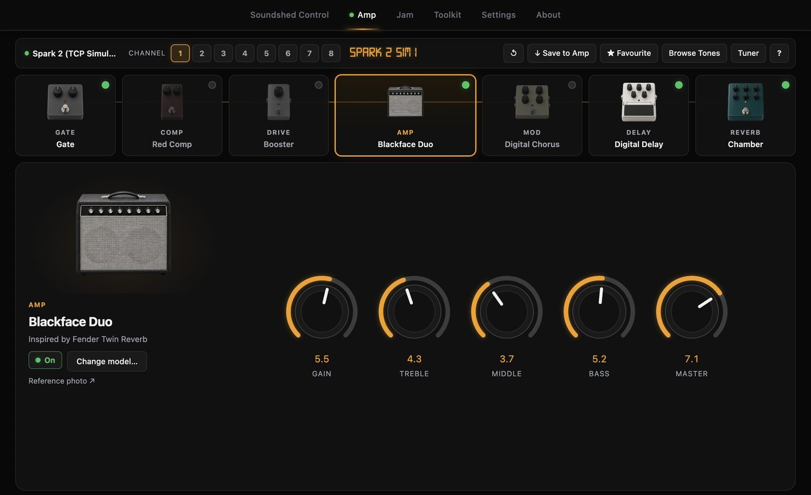
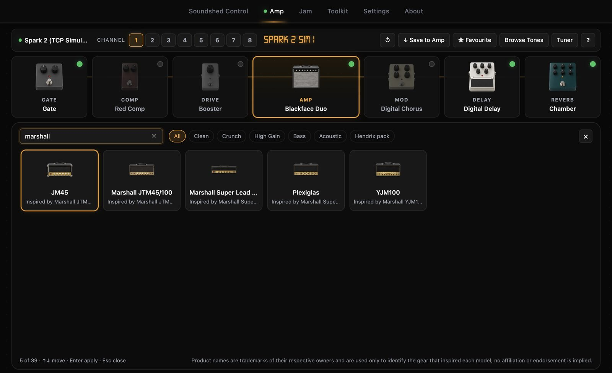
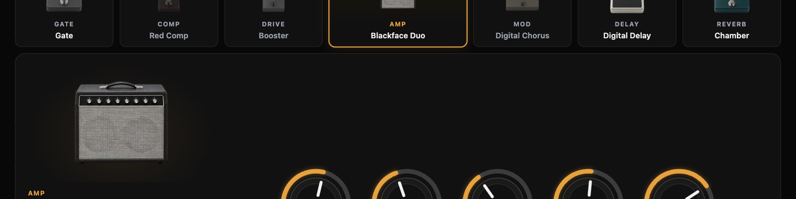
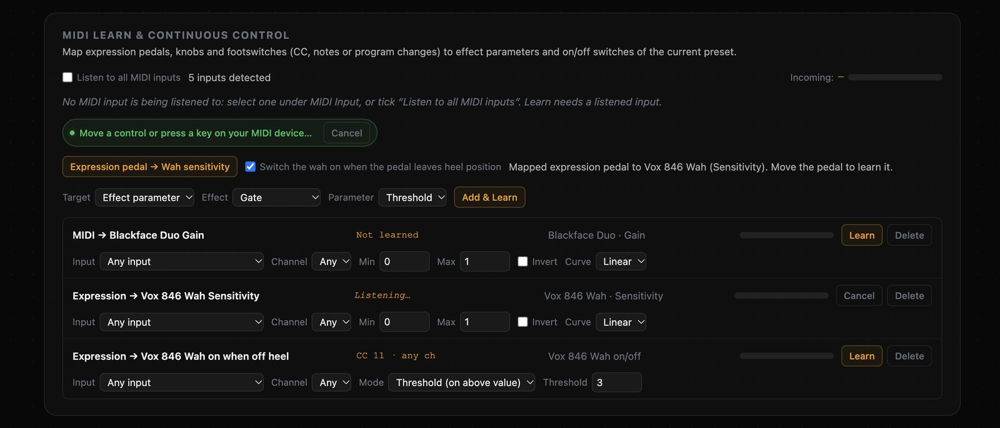

# Soundshed Control

Desktop and Web UI which can be used to:
- manage tone library and browse tone communities
- connect to supported amp via bluetooth, edit the signal chain, store presets to the amp's channels
- use the amp's tuner
- drive effect parameters, on/off switches and channels from MIDI controllers and expression pedals
- browse and favourite video backing tracks

See https://soundshed.com for info.

Windows 10 or later, macOS 13 (Ventura) or later, and supported Linux distributions.
64-bit OS and Bluetooth (BLE) connectivity required.

*Supported amps:*
- Positive Grid Spark 40, Spark Mini (Spark 2, Spark GO are experimentally supported): https://www.positivegrid.com/spark/
- All amps and effects of the paid Jimi Hendrix expansion are recognised and selectable.



### Amp screen
The amp screen is laid out for a desktop window (with the tuner closed it fits 1280×860 without scrolling, and it works down to about 1024 px wide):

- **Top bar**: the connected amp, channels 1–8 on a Spark 2 (1–4 on other models), a *Live* marker while an applied tone is not stored yet, Refresh, **Save to Amp** (pick a channel, confirm before overwriting), Favourite, Browse Tones and the tuner.
- **Signal chain**: the 7 blocks (Gate, Comp, Drive, Amp, Mod, Delay, Reverb) as tiles with their on/off switch. Selecting a block opens it below with large knobs that always show their value (0–10).
- **Model browser**: *Change model…* shows the models for that block with pictures. Search by model name, the gear that inspired it or category (e.g. "marshall", "fuzz").
- **Tuner** drawer under the top bar, showing the note and how far it is off.




Knobs: drag up/down (hold Shift, Cmd or Ctrl for fine steps), use the mouse wheel (Shift for fine steps) or the arrow keys (Shift ×10), PageUp/PageDown, Home/End. Double-click resets to the model default; double-click the value or press Enter to type one.

| Keys | Action |
| --- | --- |
| 1 – 8 | Select channel (configurable in Settings; 5–8 only on a Spark 2) |
| ← / → or [ / ] | Previous / next block |
| Space | Switch the selected block on/off |
| M, or Enter on a block | Change model |
| / or Cmd/Ctrl+F | Search models |
| Cmd/Ctrl+S | Save to amp |
| Esc | Close popovers |
| ? | Show the shortcut help |

The model pictures are original illustrations without brand names or logos (see [images/fx/README.md](images/fx/README.md)). The gear that inspired a model is only named as text; product names are trademarks of their respective owners and are used only to identify that gear.

### Known Issues
- Invalid settings may crash amp, requiring amp to be switched off and on again.
- Jimi Hendrix expansion models are reported to stay silent until the official Spark app has connected to the amp once after it was switched on. The presumed reason is that the official app unlocks the purchased content with a licence-key exchange (the amp acknowledges it as `0x70`). Soundshed does not send this unlock, and the mechanism has not been verified.

## Roadmap

Possible future features include:

- More reliable amp communication
- Amp screen: undo/redo, A/B compare, a docked tone library, channel names for all 8 channels, MIDI learn from a knob
- More tone community features
- Lessons (community supplied links to video lessons etc)
- artist and song metadata for correct cross reference of tones, backing tracks and lessons.
- Support for an extensible range of amp and FX units
    - Abstraction to map device fx settings to a "soundshed" generic list of common FX.
    - For new devices implement read/write of presets/fx settings from the device and mappings to generic fx
    - Allow presets made for any device to be approximately mapped to any other support device.
    - Provide preset cloud for devices which don't natively have one.
    - Possibly extend presets to include impulse response (IR) waveforms for devices that support them.
    - Example Target devices: Line 6 Pod Go, Boss Katana MK II

#### Event Mapping
Keyboard keys and MIDI notes or program changes can be mapped to amp channels (Settings > Input Event Mappings). With fresh settings, keys 1–8 and the white keys C3, D3 … B3, C4 on MIDI channel 1 select channels 1–8; channels 5–8 only exist on a Spark 2. Settings saved by older versions keep their own table.

#### MIDI Learn & Continuous Control
Settings > *MIDI Learn & Continuous Control* maps expression pedals, knobs and footswitches (CC, notes or program changes) on any MIDI controller to effect parameters, effect on/off switches and amp channels. Add a mapping, press *Learn* and move the control. Each mapping has its own input and channel plus a live value meter; parameter mappings also have range, invert and curve, and on/off mappings a toggle, momentary or threshold mode. *Expression pedal → Wah sensitivity* maps a pedal to the Sensitivity of the wah in the current preset in one step (optionally switching the wah on once the pedal leaves heel position) and starts Learn. Choose a MIDI input under *MIDI Input* or tick *Listen to all MIDI inputs* first. The knobs on the amp screen follow the pedal.



#### Default FX
- default slot settings (fx type, parameter settings) can be applied, e.g a default Noise Gate configuration which can either be applied all the time or on demand.

----------------------------------------

## Developer Build Info

- Prerequisites: Node 24 LTS (24.13 or later in the 24.x line), npm 11.19 or higher. `.nvmrc` selects Node 24.
- Linux native BLE builds require `build-essential` and `libbluetooth-dev`.

- VS Code is the recommended editor

- If working on the Lessons portion, you will need to add your youtube-data-api key to the `/src/env.ts` file. More information available [here](https://developers.google.com/youtube/v3/getting-started). Please do not submit this file in pull requests.

- Clone this repository
- run `npm ci` on the repo path. Commit `package-lock.json` alongside dependency changes so local and CI builds use the same versions.
- Electron 45 no longer downloads its binary during install, so there is no `node_modules/electron/dist` after `npm ci`. It is fetched the first time Electron starts (e.g. `npm run start-electron`); run `npx install-electron` beforehand if you need to work offline.
- Dependency install scripts are explicitly approved in `package.json` under `allowScripts`; `.npmrc` fails installations with unreviewed scripts instead of silently skipping them. Review new scripts before approving them with `npm install-scripts approve <package>`.
- Run `npm run typecheck` to check the app and simulator tools, and `npm test` for the Vitest unit tests followed by the headless TCP integration test.
- TypeScript emits JavaScript into `build/`; webpack bundles the emitted renderer entry. `build-tools/` holds simulator output. Both directories are ignored.
- React is on 19 with Pullstate 2, which is still a prerelease (npm's `latest` tag points to it); Pullstate 1.x only supports React 18. Dependabot intentionally excludes major React/type upgrades so they can be checked against Pullstate first.

## Run Web Version
- edit platformUtils.ts to include platformUtils.web.ts, edit env.ts to be web mode
- Run `npm run watch-web` in one terminal to continuously rebuild the UI code or `npm run build-web` to just build once. Note that there is a build for the app UI and a build for the electron main process, some of which use the same files (types etc).
- Run `npx http-server build` to start local web server on http://localhost:8080/
- Example with SSL enabled: `npx http-server build --ssl -K C:/Work/Misc/ssl/localhost-key.pem -C C:/Work/Misc/ssl/localhost.pem`

## Run Electron Version
- edit platformUtils.ts to include platformUtils.electron.ts, edit env.ts not to be web mode
- Run `npm run watch-electron` in one terminal to continuously rebuild the UI code or `npm run build-electron` to just build once. Note that there is a build for the app UI and a build for the electron main process, some of which use the same files (types etc).
- Run `npm run start-electron` to launch the UI

The final installable app is packaged using electron-forge:
`npm run make`

Local installers are unsigned by default. Set `SOUNDSHED_SIGN_RELEASE=true` to enable signing; required signing credentials must be provided in the environment.

## Run with Nix
The flake builds the Electron app from source for `x86_64-linux` and `aarch64-darwin`. Amp control uses Bluetooth, so on NixOS set `hardware.bluetooth.enable = true`.

To try it without installing:
- Linux: `nix run github:soundshed/soundshed-app`
- macOS: `nix build github:soundshed/soundshed-app`, then `open result/Applications/Soundshed.app`. The macOS package is an app bundle with no `bin/`, so `nix run` doesn't work there.

To install it from a system or home-manager flake, add the input:

```nix
inputs.soundshed = {
  url = "github:soundshed/soundshed-app";
  inputs.nixpkgs.follows = "nixpkgs";
};
```

Then add the package to `environment.systemPackages` or `home.packages`:

```nix
inputs.soundshed.packages.${pkgs.stdenv.hostPlatform.system}.default
```

## Toggle between web and electron mode
- edit env.ts, set IsWebMode true/false
- edit platformUtils.ts, import required platform

## Use TCP Spark Simulator In App
1. Ensure Electron mode is selected:
    - set `IsWebMode` to `false` in `src/env.ts`
    - select the Electron import in `src/core/platformUtils.ts`
2. Build simulator tools once: `npm run build-tools`
3. Start simulator TCP mode from repo root:
    `npm run sim:spark -- --model spark-2 --transport tcp --host 127.0.0.1 --port 9124 --verbose`
4. In [src/env.ts](src/env.ts), set:
    - `SparkTransport: "tcp-sim"`
    - `SparkSimulatorHost: "127.0.0.1"`
    - `SparkSimulatorPort: 9124`
    - `SparkSimulatorModel: "spark-2"`
5. Start the app and run device scan/connect as normal. The app will show a virtual TCP simulator device instead of opening the BLE chooser.
6. To switch back to real hardware BLE, set `SparkTransport: "ble"`.

The simulator covers presets, channels, model changes, parameters and on/off switches. While its tuner is on it streams a tuner reading (`03 64`) every 60 ms, like the real amp, with a "no signal" reading (note 0, offset -1.0) now and then, and it answers the tuner state query (`02 65`). Over TCP the app spaces commands only 50 ms apart, while its BLE provider waits at least 500 ms between writes (`minWaitTimeMSBetweenCommands` in `bleProvider.ts`), so check timing-sensitive changes on hardware.

### Headless TCP Comms Test
- Run `npm run sim:spark:test` to start a temporary TCP simulator and exercise spork comms encode/decode flows without launching the app UI.
- Use `npm run sim:spark:test:quick -- --port 9124` for faster reruns after app TS is already built.
- Both use port 9124 by default; add `-- --port <n>` if a simulator is already running there.

## Unit Tests

Unit tests run on [Vitest](https://vitest.dev/) and need no hardware, simulator or network access.

```bash
npm test             # run once (then runs the TCP simulator test)
npm run test:watch   # re-run on change
```

Tests live in `__tests__` folders next to the code they cover. The core ones
cover the Spark protocol layer in `src/spork/src/devices/spark/__tests__/`,
which is the code most likely to break silently:

| File | Covers |
| --- | --- |
| `sparkMessageReader.test.ts` | msgpack primitives: float, string, on/off, cursor handling |
| `sparkCommandMessage.test.ts` | Block framing, 7-bit payload packing, command ids, multi-chunk splitting |
| `protocolRoundtrip.test.ts` | Encode → transport-normalise → decode for preset selection, effect changes and parameters, on/off, and full multi-chunk presets |
| `sparkDeviceManager.test.ts` | Device orchestration against a fake transport: Spark 2 detection, chunked upload acks, reconnect |

The round-trip tests are the important ones. They encode a command with
`SparkCommandMessage`, strip the transport header the way
`TcpProvider.trimHeader()` does, then decode it with `SparkMessageReader` and
assert the values survive. A regression in either the bit packing or the chunk
reassembly fails the round trip rather than silently corrupting amp state.

The rest are regression tests for specific fixes, such as Spark 2 detection,
reconnecting, applying tones, and the Jam and ToneCloud searches. The tuner
has its own protocol, view model and panel tests; MIDI mapping has
mapping-logic, controller and panel tests.
The amp screen has component tests in `src/components/__tests__/` (knob
input, signal chain, model browser, save picker, keyboard guards), and
`src/core/__tests__/fxModelInfo.test.ts` checks that every current (non-removed)
catalog model has metadata and a bundled picture.

CI runs `npm test` before the web build, on pushes to `main` and on pull requests.

## Release Process 
- Electron
    - ensure electron config selected
    - ensure webpack.electron.config is set to production
    - Update the version in `package.json`, its lockfile, and `src/env.ts`.
    - Push a version tag such as `v1.3.1`. The `app build` workflow requires the tag, package version and app version to match, and builds web and x64 Windows/Linux/macOS installers; Windows and macOS tagged builds are signed.
    - After the tagged build succeeds, run `Publish Draft for Tag` with the existing tag and that build's run ID. The workflow verifies the tag/commit, successful build provenance, and all three artifacts before creating or updating a draft.
    - Review release notes and publish the draft manually. The workflow refuses to change an already-published release.
- Web
    - ensure web config selected
    - ensure webpack.web.config is set to production
    - Run build and deploy files
    - The `web pages` workflow builds the web version and deploys it to GitHub Pages on every push to `main` (or run it manually). In repository Settings > Pages, set the source to "GitHub Actions".

### GitHub Actions configuration
Pull requests, main-branch pushes, and manual builds produce unsigned installers without needing private signing credentials. Builds use Node 24, `npm ci`, read-only repository permissions, pinned action revisions, and fail if expected installer artifacts are missing. Dependabot checks npm packages and GitHub Actions weekly.

Tagged releases require these repository secrets:
- `PAT_TOKEN`: read access to `soundshed/soundshed-private`, containing `signing.pfx`, for Windows signing.
- `WIN_CODE_SIGN_PWD`: Windows certificate password.
- `MACOS_CERTIFICATE`: base64-encoded Developer ID Application certificate.
- `MACOS_APP_SIGNING_PWD`: password for the macOS certificate.
- `MACOS_APPLEID`: Apple ID used for notarization.
- `MACOS_APP_SPECIFIC_PASSWORD`: Apple app-specific password for notarization, separate from the certificate password.

The signing identity/team in `forge.config.js` is Webprofusion (`2L7LP952XY`). Temporary macOS keychains and certificate files are removed after packaging. Draft publishing uses the workflow's `GITHUB_TOKEN`; no release PAT is required. Artifact retention is 14 days, so publish the draft within that window or rebuild the tag.

### Architecture
The app is built using TypeScript. For the electron version, electron/node is the host process, talking to the electron renderer and back again (the standard electron way of working). Both web and electron versions now use Web Bluetooth (BLE).

The UI is React (TypeScript variant) with bootstrap for UI css. The Pullstate library is use for app state management and a couple of view model classes exist to centralise common points of interaction with APIs, the devices and state.

The amp screen lives in `src/components/device/desk/` (`amp-desk.tsx` is the root). The amp effect catalog in `src/spork/src/devices/spark/sparkFxCatalog.ts` defines models and their parameters. `src/core/fxModelInfo.ts` adds what the UI shows on top of that: category, the gear that inspired the model, the picture in `images/fx/` and switch-type parameters. A new model needs an entry in both, plus a picture; the fxModelInfo test fails until all three exist.

Knob changes go through `DeviceViewModel.requestFxParamChange`, which keeps at most one send per parameter in flight and always delivers the latest value, so a knob drag cannot queue a backlog behind the BLE pacing.

Original template is loosely based on https://www.sitepen.com/blog/getting-started-with-electron-typescript-react-and-webpack

#### Hardware communication

See our [Spark Amp Protocol document](docs/spark-amp-protocol.md) for current understanding of the spark amp communication.

[BLE Reader Data Received Queue]

[Spark Reader Message Queue]

[App Message Reader Loop]

At the bluetooth level the app registers a listener to consume data changes for a hardware characteristic, this delivers a stream of bytes in chunks. The app continuously queues the data recieved and looks for message terminator bytes (F7). When encountered it queues the current data for message processing higher up the chain.

The app then continuously runs a message processing loop to peek for terminated data chunks from the bluetooth reader, these are picked up from the bluetooth reader queue and parsed/interpreted into messages for our app, then added to our app message queue for later processing.
